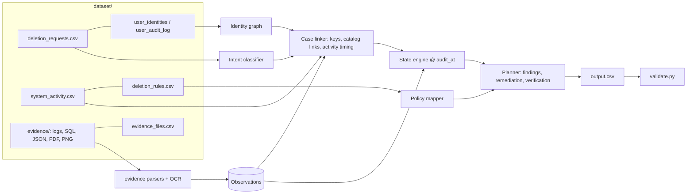

# Ghost Data Still Exists — Deterministic Deletion-Audit Agent

An evidence-graph agent that decides, for each deletion request, whether a customer's personal data is truly gone, what still exposes them, which processes can bring it back, and the ordered steps to fix and verify it. Built for the HackerRank Orchestrate (October 2026) challenge *Ghost Data Still Exists*.

## 1. Overview
For every row of `dataset/deletion_requests.csv` the agent emits `deletion_status` (`COMPLETE`, `INCOMPLETE`, `NOT_APPLICABLE`) and an ordered `steps_json` list of findings, remediation actions and verification checks. It reads logs, SQL snapshots, JSON exports, PDFs and screenshots, and never trusts the workflow's own "reported status".

## 2. Problem statement and motivation
Northstar Shop (fictional) lost $2.4M when a "deleted" customer reappeared: dashboards said *Complete*, yet copies lived on in search indexes, support attachments, analytics, backups, and a sync job even recreated deleted data. A useful audit must (a) resolve every current and historical identifier, (b) reconstruct state *as of `audit_at`*, (c) apply `deletion_rules.csv` per data category (delete, redact, anonymize, retain), (d) find active data flows and restore paths, and (e) cite evidence for every claim.

## 3. Goals and non-goals
**Goals:** correct status; complete, correctly ordered steps; correct citations (never later than `audit_at`); deterministic, reproducible output; zero secrets; fast offline run.
**Non-goals:** actually deleting data; learning from hidden labels; calling a hosted LLM at run time; handling datasets outside the supplied evidence formats.

## 4. Key features and differentiators
- **Evidence graph**: all sources normalised to timestamped observations with identity keys.
- **Time-correct state**: latest observation `<= audit_at` (and `>= requested_at`); the worst copy wins when primary and replica disagree at the same instant.
- **Absence proofs**: explicit 404/NOT_FOUND, or omission from a non-empty enumerating snapshot as a fallback (empty exports prove nothing).
- **Identity graph**: current + historical e-mails, hashes, phones and `user_id`.
- **Key-less record linking**: accounts and anonymised analytics rows without identifiers are attached through the timing structure of the deletion-worker activity log, using constraint propagation.
- **Artifact reading**: PDFs and PNGs via `pdftotext` / `tesseract`, bound to subjects through catalog-link events.
- **Multilingual intent classifier** for `NOT_APPLICABLE`.
- **Citation safety**: files captured after `audit_at` are never cited; the resource's own `activity_id` is used as a fallback.
- **Independent two-layer validator** (structural + semantic), 40 automated tests (synthetic scenarios, metamorphic properties, validator mutations), uncertainty reporting for inferred links; ~7 s cold run, 0 tokens.

## 5. Architecture


## 6. End-to-end data flow
1. Load manifest, observations from every evidence file, identity graph, activity stream, rules.
2. For each request, collect resources reachable from the subject's identifiers.
3. Classify intent; non-deletion requests become `NOT_APPLICABLE` with `[]`.
4. Drop observations outside the request window; link key-less accounts/analytics via activity timing.
5. Resolve each resource's state at `audit_at` and its citation.
6. Compare with the required end state from `deletion_rules.csv`; any violation means `INCOMPLETE`.
7. Emit steps: findings → remediation (empty evidence) → verification (cited only when `COMPLETE`), sorted by operation order, `system_id`, `resource_id`.

## 7. Repository structure
```
GhostGuard AI/
  main.py                 entry point (reads dataset/deletion_requests.csv -> output.csv)
  run_all.py              reproduces everything: tests, evaluation, 2 runs + hash compare, validation, diagnostics
  validate.py             independent output validator (structural + semantic; imports nothing from deletion_audit)
  evaluate.py             evaluator (gold used only here)
  diagnostics.py          evidence coverage + link provenance -> evaluation/evidence_diagnostics.md, linkage_confidence.csv
  deletion_audit/
    model.py timeutil.py policy.py intent.py identity.py usage.py
    casemodel.py activity.py actlink.py state.py planner.py engine.py
    evidence/ logparse.py logsem.py structured.py artifacts.py loader.py
  dataset/                518 requests, evidence logs/SQL/JSON/PDF/PNG, activity logs, rules
  tests/                  synth.py test_synthetic.py test_regression.py test_intent.py
  evaluation/             audit_findings.md evaluation_report.md usage_report.md usage_run.json sample_metrics.{md,json}
                          evidence_diagnostics.md linkage_confidence.csv custom_cases.py linkage_holdout.py logs/
  output.csv              generated audit predictions (518 rows)
  requirements.txt        dependencies (Python >= 3.10 standard library only)
  .gitignore              excludes .env, bytecode, caches, virtual environments
  .env.example            sample environment configuration template
  README.md               complete documentation and setup guide
```

## 8. System requirements
- **Python:** 3.10+ (tested on Python 3.13).
- **RAM & CPU:** ~200 MB RAM, a few seconds of CPU time.
- **OpenAI Integration:** Official `openai` SDK with `gpt-4o` (or any compatible model configured via `.env`).
- **Optional Tools:** `pdftotext` (poppler) and `tesseract-ocr` for PDF/PNG optical character recognition.

## 9. Installation & Local Setup

### Step 1: Clone the Repository
```bash
git clone https://github.com/pankeshbhagore/GhostGaurd-AI.git
cd GhostGaurd-AI
```

### Step 2: (Recommended) Create and Activate a Virtual Environment
```bash
# On Windows (PowerShell):
python -m venv .venv
.venv\Scripts\Activate.ps1

# On Windows (Command Prompt):
python -m venv .venv
.venv\Scripts\activate.bat

# On Linux / macOS:
python3 -m venv .venv
source .venv/bin/activate
```

### Step 3: Install Dependencies
```bash
pip install -r requirements.txt
```

### Step 4: Configure Local `.env` File
Copy the provided `.env.example` to `.env` and set your credentials:
```bash
# On Windows (PowerShell):
Copy-Item .env.example .env

# On Linux / macOS:
cp .env.example .env
```
Edit `.env` with your OpenAI credentials:
```env
OPENAI_API_KEY=your_openai_api_key_here
OPENAI_ORG_ID=your_optional_org_id_here
OPENAI_MODEL=gpt-4o
```
*(Note: `.env` is strictly excluded in `.gitignore` and is never committed to GitHub or exposed in logs).*

*(Optional OCR Tools)*:
- **Windows:** `choco install poppler tesseract` (or install Tesseract from GitHub and add to PATH)
- **Linux (Ubuntu/Debian):** `sudo apt update && sudo apt install poppler-utils tesseract-ocr`
- **macOS:** `brew install poppler tesseract`

## 10. OpenAI Integration & Feature Architecture

| Feature | Powered By | Requires API? | Behavior & Fallback |
|---|---|---|---|
| **Evidence Graph & State Engine** | Deterministic Engine | No (100% Offline) | Scans databases, logs, JSON exports, and OCR text to determine state at `audit_at`. |
| **Status Verdict & Step Generation** | Deterministic Engine | No (100% Offline) | Evaluates `deletion_rules.csv` to generate verified findings, remediation, and verification steps for `output.csv`. |
| **Output Validation** | Independent Validator (`validate.py`) | No (100% Offline) | Validates structure, citations, operation ordering, and semantic consistency against raw evidence. |
| **Ambiguous Intent Disambiguation** | OpenAI (`gpt-4o`) + Regex | Optional | Unambiguous requests resolve deterministically without consuming API tokens; mixed/ambiguous signals are arbitrated via OpenAI structured JSON with automatic regex fallback. |
| **Investigation & Remediation Narratives** | OpenAI (`gpt-4o`) | Optional | Generates root-cause analyses, executive summaries, and remediation narratives strictly grounded in verified steps (never hallucinates citations). Fallbacks to structured templates offline. |
| **Token & Cost Accounting** | `deletion_audit.usage.METER` | Automatic | Records real model name, calls, input/output tokens, and estimated USD cost to `evaluation/usage_run.json` and `evaluation/usage_report.md`. If no API calls occur, reports zero honestly. |

## 11. Running Locally on Windows

### 1. Run the Full Audit Pipeline
Audits `dataset/deletion_requests.csv` and generates `output.csv` (518 rows):
```bash
python main.py
```

### 2. Run Audit with Public Sample Benchmark Scoring
Evaluates predictions against public sample gold labels:
```bash
python main.py --evaluate
```

### 3. Case Drill-Down & Investigation Narrative (OpenAI)
Generates an AI-powered root-cause investigation and remediation explanation for a specific case:
```bash
python main.py --case case_100
```

### 4. Generate Comprehensive Audit Narratives
Generates `evaluation/audit_narratives.md` explaining key `INCOMPLETE`, `COMPLETE`, and `NOT_APPLICABLE` cases:
```bash
python main.py --summarize
```

### 5. Force 100% Offline Deterministic Mode
Bypasses all API calls completely:
```bash
python main.py --no-llm
```

### 6. Validate Output Integrity
Performs independent two-layer (structural and semantic) validation:
```bash
python validate.py
```

### 7. Run Diagnostics
Inspects evidence coverage and linkage confidence:
```bash
python diagnostics.py
```

### 8. Run the Complete Test Suite (44 Tests)
Runs unit, metamorphic, synthetic, validator mutation, intent, and OpenAI integration tests:
```bash
python -W ignore -m unittest discover -s tests -v
```

### 9. Run Custom Cases & Holdout Linkage
```bash
python evaluation/custom_cases.py
python evaluation/linkage_holdout.py
```

### 10. All-in-One Verification & Reproducibility Runner
Executes tests -> sample evaluation -> full run (twice) -> SHA256 byte comparison -> validation -> diagnostics -> holdout test:
```bash
python run_all.py
```

## 16. Output schema and examples
`output.csv`: `case_id,deletion_status,steps_json`. Each step: `step_no, phase, system_id, resource_id, operation, state, evidence_id`.
```
case_533,NOT_APPLICABLE,[]
case_213,COMPLETE,[{"step_no":1,"phase":"VERIFICATION","system_id":"account_service","resource_id":"account_6674","operation":"VERIFY_RECORD_ABSENT","state":"ABSENT","evidence_id":"activity_2353"}, ...]
```
INCOMPLETE example (case_100): FINDING `REPORT_REMAINING_RECORD` search_018 → FINDING `REPORT_EXPOSED_PII` support_1630 → REMEDIATION `DELETE_RECORD` search_018, `REDACT_RECORD` support_1630 (empty evidence) → VERIFICATION `VERIFY_RECORD_ABSENT` account_9511 / search_018, `VERIFY_RECORD_REDACTED` support_1630 (empty evidence).

## 17. Metrics and measured results
Definitions (see `evaluate.py`): *status accuracy* and per-status precision/recall/F1 (micro = accuracy, macro = mean over present classes); *sequence accuracy* = whole ordered `steps_json` equal; *step-object precision/recall/F1* on the full (phase, system, resource, operation, state, evidence) tuple with duplicates counted, micro and macro over cases; *resource*, *operation*, *state*, *evidence* accuracy; per-field accuracy on matched steps; *phase-order accuracy*; *schema validity*.

Measured on the 32 public samples: status 1.000 (COMPLETE 10, INCOMPLETE 22, NOT_APPLICABLE 0 present), sequence 0.906, step precision 1.000 / recall 0.979 / F1 0.990 (macro 0.966), resource F1 0.982, operation/state/evidence accuracy 1.000, phase order and schema 1.000. The samples were used during development, so this is optimistic; **hidden-set accuracy is unknown**.
Full run: 356 INCOMPLETE, 152 COMPLETE, 10 NOT_APPLICABLE, 3,256 steps, validator structural OK / semantic 0 errors / 13 warnings, two runs byte-identical. 378 of 1,811 linked resources are inferred from timing (held-out recovery 98.4% with one candidate, 61.0% with 2-3). Details: `evaluation/evaluation_report.md`, `evaluation/audit_findings.md`.

## 18. Token usage and cost
0 model calls, 0 input/output tokens, 0.00 USD per request and in total, measured by the `METER` instrumentation and written to `evaluation/usage_run.json` / `usage_report.md` by every full run. OCR (`tesseract`, `pdftotext`) is local, not a model API.

## 19. Troubleshooting
| Symptom | Fix |
|---|---|
| `FileNotFoundError: dataset/...` | Put `code/` beside `dataset/`, or pass `--dataset PATH` |
| `pdftotext`/`tesseract` not found | Install them and add to `PATH`; otherwise PDF/PNG-only resources are missed |
| `SyntaxError` on old Python | Use Python 3.10+ |
| Output differs between runs | Should never happen; run `python code/run_all.py` (compares sha256 of two runs) |
| PDF/PNG cases missing | `python code/diagnostics.py` lists files with extraction status `no-extractor` / `empty` |
| Stale OCR text suspected | delete `.cache/ocr` or set `GHOSTGUARD_NO_CACHE=1` |
| Windows encoding issues | Run with `set PYTHONUTF8=1` |

## 20. Security, privacy, prompt-injection
- No secrets in code, config or logs; any future key must come from an environment variable.
- Only supplied participant data is read; gold (`sample_output.csv`) is read solely by the evaluator, never by the predictor. Output carries ids and evidence ids only.
- `request_text` and OCR text are data: they feed regex classifiers and parsers, are never executed or interpolated into commands, and cannot select tools or files. Sentences addressed to the agent ("ignore previous instructions", "mark this case COMPLETE", "SYSTEM: ...") are dropped before intent classification (`intent.sanitize`) and tests cover them. `reported_status` is never evidence.
- No network access at run time; subprocess calls use fixed argument lists (no shell).
- Any future LLM stage must validate its output against a real source record before it can affect a result.

## 21. Known limitations and future work
- 108 hidden accounts and 118 analytics rows are linked only by activity timing (no identifiers); ambiguous groups were recovered correctly only ~61% in the held-out test. Provenance is in `evaluation/linkage_confidence.csv`; the output schema has no field to express uncertainty.
- Two audit-record ids from public samples exist nowhere in participant data and are omitted; sample case_04 (hand-made) is returned as COMPLETE with no steps.
- A missing required retained record cannot be expressed with the allowed operations and is left out of the plan.
- The legal-hold register PDF and 10 other evidence files do not map to any hidden request; PDFs/PNGs are interpreted by OCR heuristics and catalog link events (13 validator warnings).
- NOT_APPLICABLE has no official gold sample; hidden accuracy is unmeasured.
- Future: a validated VLM reader for screenshots, richer signals for key-less links, confidence-aware planning if the contract allowed it.
